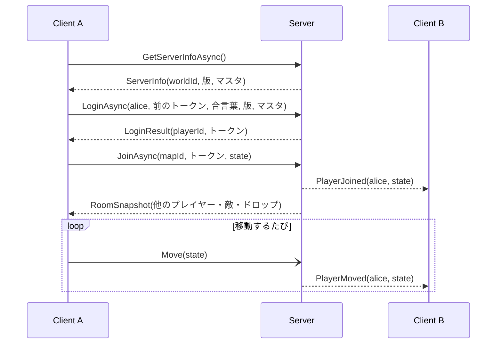
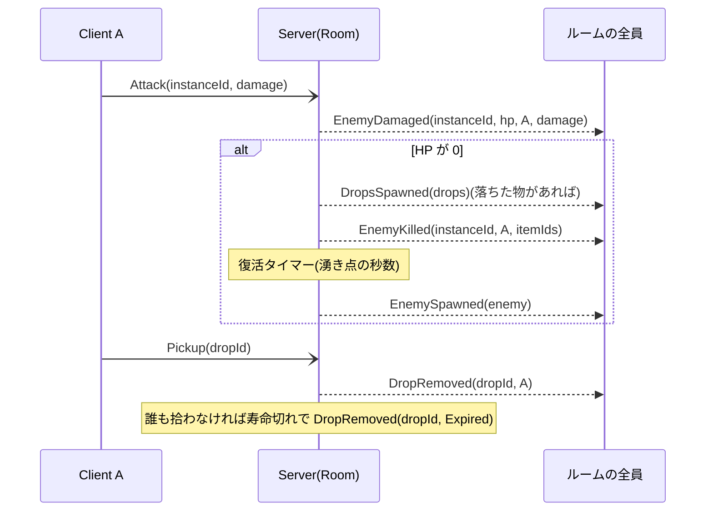
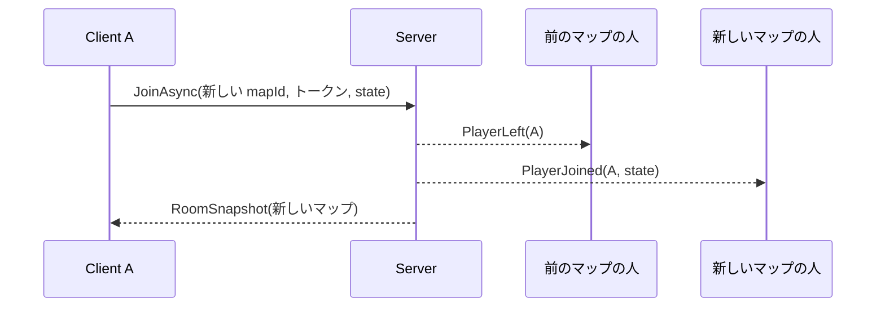

# 通信

メソッドと DTO の正は `Terrace.Server/src/Terrace.Shared/`。ここには約束ごとと流れを書く。

## 経路

- MagicOnion 7.10(gRPC)、シリアライザは MessagePack
- TLS なしの HTTP/2(h2c)。ポートは `TerraceServerOptions.GrpcPort`(既定は `appsettings.json`)
- 状態確認用に HTTP/1.1 のポート(`HttpPort`)で `GET /` が接続先・読み込んだマップとマスタ・ルームの状況を JSON で返す
- Unity からは YetAnotherHttpHandler(`Http2Only`)で繋ぐ(`MagicOnionConnection`)。テストクライアントは .NET の既定のハンドラ
- 暗号化なし。すべてインメモリ(サーバーを止めると、キャラクターもトークンも消える)

## Unary: `IAccountService`

| メソッド | 動き |
|---|---|
| `GetServerInfoAsync()` → `ServerInfo` | ログインの前に聞ける、ワールドの情報(ワールドの ID と名前、プロトコルの版、マスタの sha256、合言葉が要るか、今いる人数) |
| `LoginAsync(LoginRequest)` → `LoginResult` | 版の握手と合言葉を確かめてから(`LoginGate`)、キャラクターを返す。`Token` がこのワールドで知っているものなら同じキャラクター(同じ `PlayerId`、名前は前のまま)、無いか知らないものなら新しいキャラクターを作り、新しいトークンを発行する。名前は表示用(空なら `guest`、長すぎれば切る)。キャラクターは最初のマップにいる |

ワールドとトークン:

- ワールドの ID(`WorldIdentity`)は、起動のときに作る推測できない乱数。保存がまだ無いので、起動のたびに変わる。Client はトークンをワールドの ID ごとに覚えるので、前の起動のトークンは使われない
- ワールドの名前と合言葉は `TerraceServerOptions.WorldName` / `JoinPassword`(空なら合言葉は要らない)
- トークン(`AccountRegistry.TokenBytes` の乱数)は本人を示す。本人への `LoginResult` にだけ入れ、Server のログに出さない
- ID と名前は Server がトークンから決める。Client が名乗った ID や名前は使わない

ログインを断るとき(`LoginGate`)。文言は `Status.Detail` に入れ、Client はそのまま人に見せる:

| 理由 | コード |
|---|---|
| `ProtocolVersion` が `ProtocolVersion.Current` と違う | `FailedPrecondition` |
| `MasterSha256` がサーバーのマスタと違う(空なら比べない。マスタを持たないテストクライアントのため) | `FailedPrecondition` |
| 合言葉の要るワールドで、合言葉が違う・空 | `PermissionDenied` |

## StreamingHub: `IGameHub`(Client → Server)

1 接続 = 1 プレイヤー。参加前(`JoinAsync` 前)の呼び出しは無視される。1 つの `PlayerId` を使えるのは最後に参加した 1 接続だけで(`PlayerConnections`)、同じ ID で別の接続が参加すると先の接続を置き換える。置き換えられた接続の呼び出しは無視され、何も届かず、その接続が切れても後から来た接続は消えない(接続そのものは Server からは切らない)。

要求の引数は DTO 1 つ。`Move` / `Attack` / `Pickup` は `void` で、送りっぱなしにする(Server は返事をしない。結果は通知で届く)。返事を待つのは、断られたことを知る必要がある `JoinAsync` と、切る前に送り切りたい `LeaveAsync` だけ。

| メソッド | Server の動き | 届く通知 |
|---|---|---|
| `JoinAsync(JoinRequest)` | `Token` からキャラクターを引き、知らないトークンなら参加させず、`PermissionDenied` で失敗を返す(要求が空なら `InvalidArgument`)。すでにどこかのルームにいれば先に退出。同じ ID の別の接続がいれば外す(別のマップなら、そのルームから退出させる)。ルームが無ければ作る。`State` の位置で参加 | 本人に `RoomSnapshot`、他の人に `PlayerJoinedNotification`(置き換えで別のマップから来たなら、元のマップの人に `PlayerLeftNotification`) |
| `LeaveAsync()` | 退出。ルームが空になれば破棄 | 他の人に `PlayerLeftNotification` |
| `Move(MoveState)` | `IMoveValidator` を通れば位置を保持 | 他の人に `PlayerMovedNotification` |
| `Attack(AttackRequest)` | 敵の HP を減らす。0 なら死亡・ドロップ抽選・復活タイマー | 全員に `EnemyDamagedNotification`、倒したら `DropsSpawnedNotification`(落ちた物があれば)→ `EnemyKilledNotification` |
| `Pickup(PickupRequest)` | まだ落ちていれば取り除く(早い者勝ち) | 全員に `DropRemovedNotification` |

送りっぱなしの要求が断られても(検証を通らない移動、いない敵への攻撃、もう無い落とし物)、本人には何も届かない。本人に断ったことを知らせたい要求を足すときは、本人宛ての通知を足す。

切断されると自動で退出する。Server は StreamingHub の heartbeat を `TerraceServerOptions.HeartbeatIntervalSeconds` ごとに送り、`HeartbeatTimeoutSeconds` の間に応答が無ければ接続を切る(Client のクラッシュ・回線断・スリープのように、切断の知らせが届かないときも退出する)。Client(MagicOnion.Client)は自動で応えるので、Client 側の設定は要らない。

## Receiver: `IGameHubReceiver`(Server → Client)

通知はすべて `OnNotification(INotification)` の 1 本で届く。`INotification` は MessagePack の Union で、受け取った側は型で振り分ける。

| 通知 | 中身 | いつ | 誰に |
|---|---|---|---|
| `RoomSnapshot` | マップ ID、自分以外のプレイヤー、敵、落とし物 | 参加した直後 | 本人だけ |
| `PlayerJoinedNotification` | `Player`、`State` | 誰かが参加した | 本人以外 |
| `PlayerLeftNotification` | `PlayerId` | 誰かが退出・切断した | 本人以外 |
| `PlayerMovedNotification` | `PlayerId`、`State` | 誰かの移動が受け入れられた | 本人以外 |
| `EnemySpawnedNotification` | `Enemy` | 敵が復活した(最初に湧いた分は `RoomSnapshot` に含む) | 全員 |
| `EnemyDamagedNotification` | `EnemyInstanceId`、`Hp`、`AttackerPlayerId`、`Damage` | 攻撃が当たった | 全員 |
| `EnemyKilledNotification` | `EnemyInstanceId`、`KillerPlayerId`、`DroppedItemIds` | 敵が死亡した | 全員 |
| `EnemiesMovedNotification` | `Enemies`(動く生きた敵の位置) | 一定間隔(`Room.EnemyMoveBroadcastInterval`)。プレイヤーがいるときだけ | 全員 |
| `DropsSpawnedNotification` | `Drops` | 敵がアイテムを落とした | 全員 |
| `DropRemovedNotification` | `DropId`、`PlayerId` | 拾われた(`PlayerId`)/ 寿命切れ(`DropRemovedNotification.Expired`) | 全員 |

「全員」「本人以外」はそのルーム(マップ)の参加者。誰に届けるかは `Room` が決め(`IRoomEventSink.Broadcast` / `BroadcastExcept`)、配信グループは mapId ごと、キーは `PlayerId`。

## DTO

要求と通知のほかに、中で使う DTO。

| DTO | 中身 |
|---|---|
| `PlayerInfo` | `PlayerId`、`Name` |
| `CharacterInfo` / `LoginResult` | キャラクター(名前・レベル・マップ・位置)とプレイヤー ID、トークン、ワールドの ID |
| `ServerInfo` | ワールドの ID と名前、プロトコルの版、マスタの sha256、合言葉が要るか、今いる人数 |
| `MoveState` | 座標・速度・向き(`Facing`)・動作(`MotionState`: Stand / Walk / Jump / Ladder / Crouch / Attack / Dead) |
| `EnemyState` | インスタンス ID・敵 ID・位置・HP・最大 HP・死亡・向き |
| `EnemyMoveState` | インスタンス ID・位置・向き |
| `DropState` | ドロップ ID・アイテム ID・位置 |
| `PlayerSnapshot` | プレイヤー 1 人(`PlayerInfo` と `MoveState`) |
| `LoginRequest` / `JoinRequest` / `AttackRequest` / `PickupRequest` | 要求の引数(表の「メソッド」) |

## 流れ

### ログインから参加、移動の中継

図の通知は `Notification` を略して書く。

### 攻撃から復活まで

### マップ移動

## 互換の決まり

- `Terrace.Shared` は netstandard2.1 / C# 9(Unity からも同じソースを使うため)
- DTO の `[Key(n)]` と、`INotification` の `[Union(n, ...)]` の番号は、付け替えない・使い回さない。足すときは末尾の次の番号にする
- 古い Client と新しい Server の組み合わせ(またはその逆)は考えない。通信の定義を変えたら、Server・Client・テストクライアントを同じ変更で直し、`ProtocolVersion.Current` を 1 上げる。版が違えば、ログインで断る
- IL2CPP 向けには MessagePack と MagicOnion のコード生成が別途要る。今の Unity Client は MagicOnion の動的生成を使う(エディタと Mono ビルドでだけ動く)
- 変えたら Client にも写す(`Terrace.Client/tools/sync-shared.ps1`)。新しいファイルには Unity の `.meta` も要る

### 通知を 1 つ足すとき

1. `Terrace.Shared/Dto/Notifications.cs` に DTO(`[MessagePackObject]`、`INotification` を実装)を作り、`INotification` に `[Union]` を 1 行足す。Union に足し忘れると Server のテスト(`NotificationTests`)が落ちる。`ProtocolVersion.Current` を 1 上げる
2. 送る側: ルームの出来事なら `Room` から `IRoomEventSink.Broadcast` / `BroadcastExcept` で送る。本人だけに送るなら Hub の `Client.OnNotification`
3. 受ける側: Client の `OnlineSession.Apply`(他のプレイヤーなど)か `RoomMirror.Apply`(敵と落とし物)に、型の分岐を 1 つ足す
4. `Terrace.Client/tools/sync-shared.ps1` で写す
5. この文書の Receiver の表に 1 行足す

受け箱(`OnlineInbox`)、`IRoomEventSink` と `GroupRoomEventSink`、テストの記録用 Sink、テストクライアントの `LoggingReceiver` は、通知の種類を知らないので直さなくてよい(テストクライアントは知らない通知を型の名前だけでログする。中身を出したいときだけ分岐を足す)。

### 要求を 1 つ足すとき

1. `Terrace.Shared/Dto/Requests.cs` に要求の DTO を作り、`IGameHub` にメソッドを足す。返事が要らなければ `void`。`ProtocolVersion.Current` を 1 上げる
2. Server の `GameHub` に実装を足す(ロジックは `Room` などの純 C# に置き、Hub は呼ぶだけ)
3. Client の送り口 `IOnlineChannel` と、その実装の `MagicOnionConnection`、テストの偽物(`FakeChannel`)に足す
4. 使うならテストクライアント(`Terrace.TestClient`)にも足す
5. `Terrace.Client/tools/sync-shared.ps1` で写し、この文書の IGameHub の表に 1 行足す

## Client でのログイン

- ログインの前に `GetServerInfoAsync` で版を確かめ、違えば繋がない(`GetServerInfoAsync` が無い古いサーバーも、版が違うとして扱う)
- トークンは、ワールドの ID ごとに PlayerPrefs に覚え、次のログインで送る(`OnlineSettings`)。送るマスタの sha256 は、StreamingAssets の manifest から読む
- 版・マスタ・合言葉で断られたら、ログイン窓にその理由を出す(`LoginRejectedException`)
- 合言葉は、今は起動引数 `-terracePassword` だけで渡す

## Client での受け取り方

- 通知は `OnlineInbox` に積むだけにして、`GameSimulation.Step` の頭でメインスレッドから古い順に反映する(`OnlineSession.Pump`)
- `JoinAsync` を送ったあと、そのマップの `RoomSnapshot` が届くまでは他の通知を捨てる(マップ移動の直後に前のマップの通知が遅れて届くため)。`RoomSnapshot` の `MapId` が今のマップと違えば、それも捨てる
- 知らない通知(振り分けに無い型)は読み飛ばす
- 自分自身の `PlayerJoinedNotification` / `PlayerMovedNotification` は数えない
- `EnemyKilledNotification` は、すでに死んでいる敵については何もしない(重ねて届いても報酬は 1 回)
- 移動は毎フレームは送らない。いつ送るかは `MoveSender` が決める(状態や向きが変わったらすぐ、位置だけなら間隔を空けて、止まっていても時々)
- 切断(`WaitForDisconnect` の完了、参加の失敗、送信の失敗)は受け箱に印を付け、次の `Step` でオフラインに切り替える
